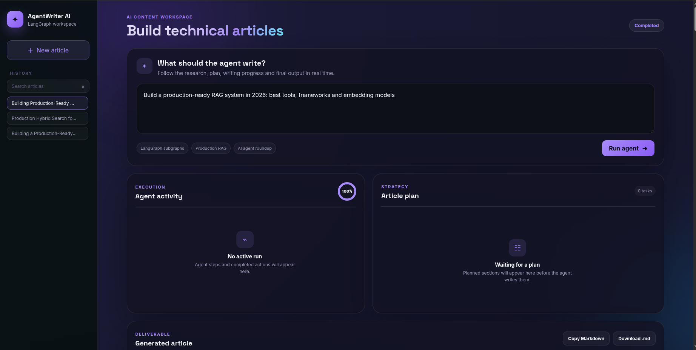
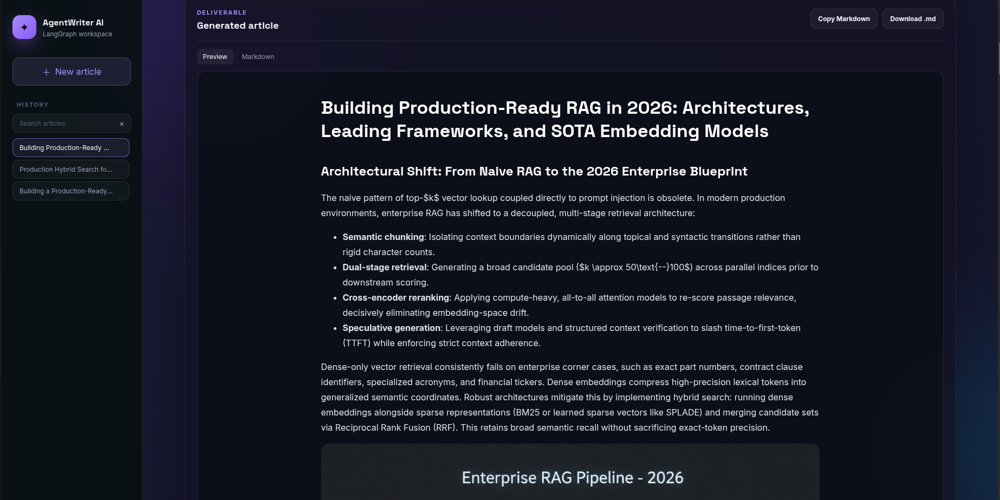
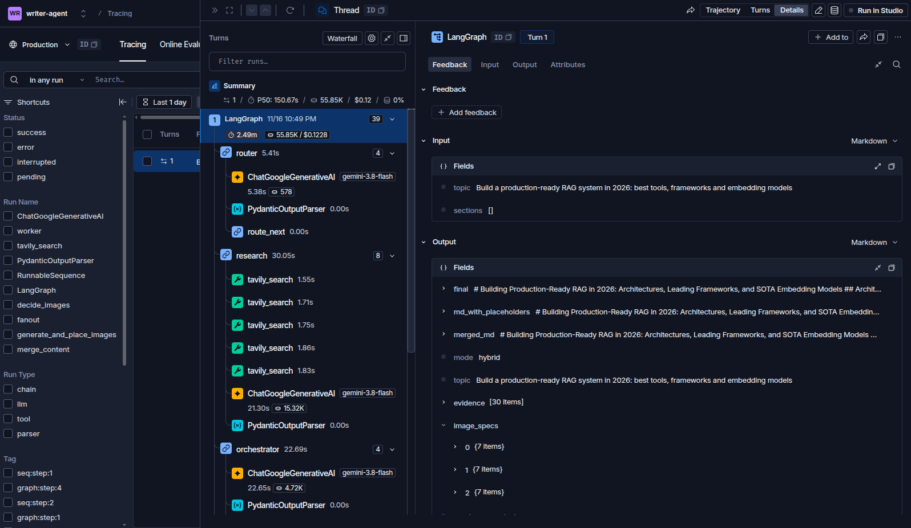

# Agent Writer

A FastAPI web app that runs a LangGraph agent to write blog articles. The agent routes the request, researches the topic with Tavily, plans sections, writes them in parallel, merges them, and optionally generates and places images with Gemini. Runs are saved to PostgreSQL and the finished articles can be downloaded as Markdown.

## Demo

Workspace where you enter a topic and run the agent:



A generated article in preview mode:



The same run traced in LangSmith (project `writer-agent`), showing each graph node, tool call, and LLM call:



## Workflow

```
START -> router -> research (optional) -> orchestrator -> worker (one per section, in parallel)
      -> reducer (merge content -> decide images -> generate images) -> END
```

- **router**: decides whether the topic needs web research.
- **research**: searches the web with Tavily.
- **orchestrator**: plans the article outline.
- **worker**: writes each section.
- **reducer**: merges sections, decides where images go, and generates them.

## Requirements

- Python 3.12+
- PostgreSQL 16 (or use Docker Compose)
- API keys: Gemini and Tavily

## Setup

1. Copy the environment template and fill in your values:

   ```bash
   cp .env.example .env
   ```

2. Install dependencies:

   ```bash
   python -m venv .venv
   source .venv/bin/activate
   pip install -r requirements.txt
   ```

3. Make sure `DATABASE_URL` in `.env` points to a running PostgreSQL database.

## Run locally

```bash
uvicorn app:app --reload
```

Open http://127.0.0.1:8000.

## Run with Docker

```bash
docker compose up -d --build
```

This starts PostgreSQL and the app. The app is served on `APP_PORT` (default `8000`). To view logs:

```bash
docker compose logs -f app
```

## Environment variables

| Variable | Purpose |
| --- | --- |
| `GEMINI_API_KEY` | Text generation and image generation |
| `TAVILY_API_KEY` | Web research |
| `DATABASE_URL` | PostgreSQL connection string |
| `POSTGRES_USER`, `POSTGRES_PASSWORD`, `POSTGRES_DB`, `POSTGRES_PORT` | Used by Docker Compose |
| `APP_PORT` | Host port for the app (Docker) |
| `LANGSMITH_TRACING` | Set to `true` to send traces to LangSmith |
| `LANGSMITH_API_KEY` | LangSmith API key |
| `LANGSMITH_PROJECT` | LangSmith project name (default `writer-agent`) |

## API

| Method | Path | Description |
| --- | --- | --- |
| GET | `/` | Web UI |
| GET | `/api/health` | Health check |
| POST | `/api/run` | Start an agent run (streams output) |
| GET | `/api/articles` | List saved articles |
| GET | `/api/articles/{article_id}` | Get one article |
| DELETE | `/api/articles/{article_id}` | Delete an article |
| GET | `/api/runs/{run_id}/download` | Download an article as Markdown |

## Project structure

```
app.py            FastAPI app and API routes
backend.py        LangGraph workflow, LLM and tool setup, database checkpointing
templates/        HTML template for the UI
static/           CSS and JavaScript
images/           Generated images (created at runtime)
outputs/          Generated articles and images (created at runtime)
docker-compose.yml  App and PostgreSQL services
Dockerfile        App image
```

## Tracing

With `LANGSMITH_TRACING=true` and a valid `LANGSMITH_API_KEY`, every run is traced in LangSmith under the `LANGSMITH_PROJECT` name. No code changes are needed.
